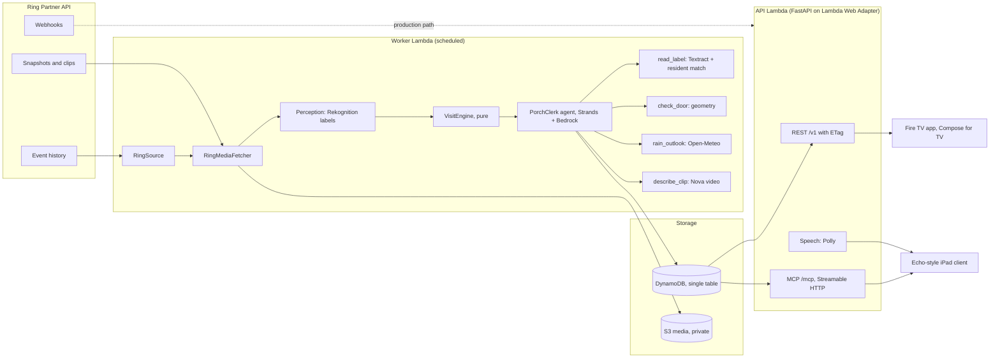

# Architecture

## System

### Data flow for one delivery

1. The worker polls Ring event history from a stored cursor. The Playground sends no webhooks, so polling is the sandbox path; `POST /ring/webhook` with HMAC verification is the production path.
2. For each event it fetches three snapshots (start, middle, end of the event) and the clip, stores them in S3 under their SHA-256, and labels each snapshot with Rekognition. A media file is analysed once.
3. The VisitEngine groups events that are less than two minutes apart, tracks boxes on the porch across snapshots by IoU, and classifies each closed group: delivery, box gone, car stopped, visitor, cars passed or activity. It is a pure function with property tests (idempotent, order-independent, incremental runs equal one batch run).
4. PorchClerk, a Strands agent on Bedrock, decides which enrichment tools a visit needs. Each tool calls the same step functions as the deterministic path, refuses to run when its precondition is false, and is timed into the visit's trace. If the agent times out, exceeds its tool budget or errors, the deterministic path runs and the trace says so.
5. The visit is saved with a version number; the house version feeds a strong ETag, so the TV app's five-second poll costs a 304 when nothing changed.
6. The TV app shows the day as cards; the iPad client calls MCP tools such as `anything_for_me` and plays the answer through Polly.

### Design choices

- **Ports and adapters.** Every external system sits behind a Protocol in `porch/ports.py`. Each has a live adapter, a record/replay cassette and a test fake, so `just demo` and the whole test suite run with no network and no keys.
- **Deterministic core, agent at the edge.** Stitching and the rules are plain code with tests. The agent only chooses among tools whose effects are already tested, which keeps its failure modes small.
- **One settings object.** Every threshold, window, model id and limit is in `porch/config.py` and can be overridden with `PORCH_` environment variables.
- **Shared contracts.** `contracts/openapi.json` and `contracts/mcp-tools.json` are generated from the code and checked in CI. The TV app's tests read the same golden JSON files the backend writes, so the Python and Kotlin sides cannot drift apart silently.

## Dependencies and why

- pydantic: typed models at every external boundary (settings, API payloads, tool IO).
- pydantic-settings: one Settings object fed by PORCH_ env vars, frozen and validated.
- rapidfuzz: fuzzy name matching for delivery label OCR in the pure domain (token_set_ratio).
- tzdata: IANA timezone database so zoneinfo works on hosts without a system tz database (Windows dev machines).
- fastapi: REST and media endpoints in porch.api (routing, validation, OpenAPI).
- uvicorn: ASGI server for `porch serve`.
- mcp: Model Context Protocol Python SDK v2 for the household tools over Streamable HTTP.
- httpx (dev): Starlette TestClient transport for API tests.
- pillow: image crop for delivery label OCR in enrich, and synthetic tape frames in tests/demo.
- boto3: S3 media, Rekognition labels, Textract OCR, Polly speech, Bedrock Nova clip descriptions; each call runs in asyncio.to_thread under a per-service semaphore.
- types-boto3 (dev): client and type stubs so the AWS adapters stay under mypy strict.
- httpx2: async HTTP for Open-Meteo; the same fork the MCP SDK already vendors, so one HTTP client total.
- hatchling: PEP 517 build backend for the src-layout `porch` package.
- pytest: unit and integration tests.
- hypothesis: property tests for the pure engine and geometry code.
- mypy: static types, strict mode, pydantic plugin.
- ruff: lint and format in one tool.
- strands-agents: agent loop and tool calling for the AWS Builder track; only the worker imports it.

## TV app dependencies (Gradle, tv/)

- Android Gradle Plugin 8.13.2 + Kotlin 2.4.21: the app toolchain; AGP 8.x line keeps the known Kotlin plugin wiring.
- Compose BOM 2026.04.01 + androidx.tv:tv-material 1.1.0: TV UI toolkit; the 2026.09 BOM requires AGP 9 and compileSdk 37, so the newest BOM that still builds on AGP 8 is pinned.
- Fraunces + Source Sans 3 TTFs: bundled typefaces under res/font, OFL texts in assets/licenses; Source Sans keeps unslashed zeros for time spans.
- Ktor client (OkHttp engine) + kotlinx.serialization: TV API client over the shared OpenAPI/golden contract; okhttp pinned to 5.4 because 5.5 requires compileSdk 37.
- DataStore preferences: persists the last good visit list for offline start.
- Coil 3.5.0: hero image loading on TV; 3.6.x requires compileSdk 37, 3.5 stays on 36.
- Roborazzi + Robolectric + coil-test: JVM screenshot and focus tests, goldens in tv/app/src/test/screenshots.
- Turbine + kotlinx-coroutines-test: StateFlow assertions in ViewModel tests.
- Spotless (ktlint) + detekt: TV code style and complexity gates; detekt runs on main sources only.

## Echo client dependencies (pnpm, echo/)

- Vite + Preact: minimal UI runtime for the iPad screen; the bundle stays under 120 KB gzip.
- @modelcontextprotocol/client: official TypeScript MCP client, Streamable HTTP transport, protocol pinned to 2025-11-25.
- Biome: lint and format in one tool, matching the ruff role on the backend.
- Vitest + @testing-library/preact + jsdom: unit tests for the type guards and the App.
- TypeScript 5.9: the 7.x line is the preview rewrite; 5.9 is the last stable series Vite and the presets target.
- Fraunces + Source Sans 3 WOFF2: same OFL typefaces as the TV app, converted with fonttools.

